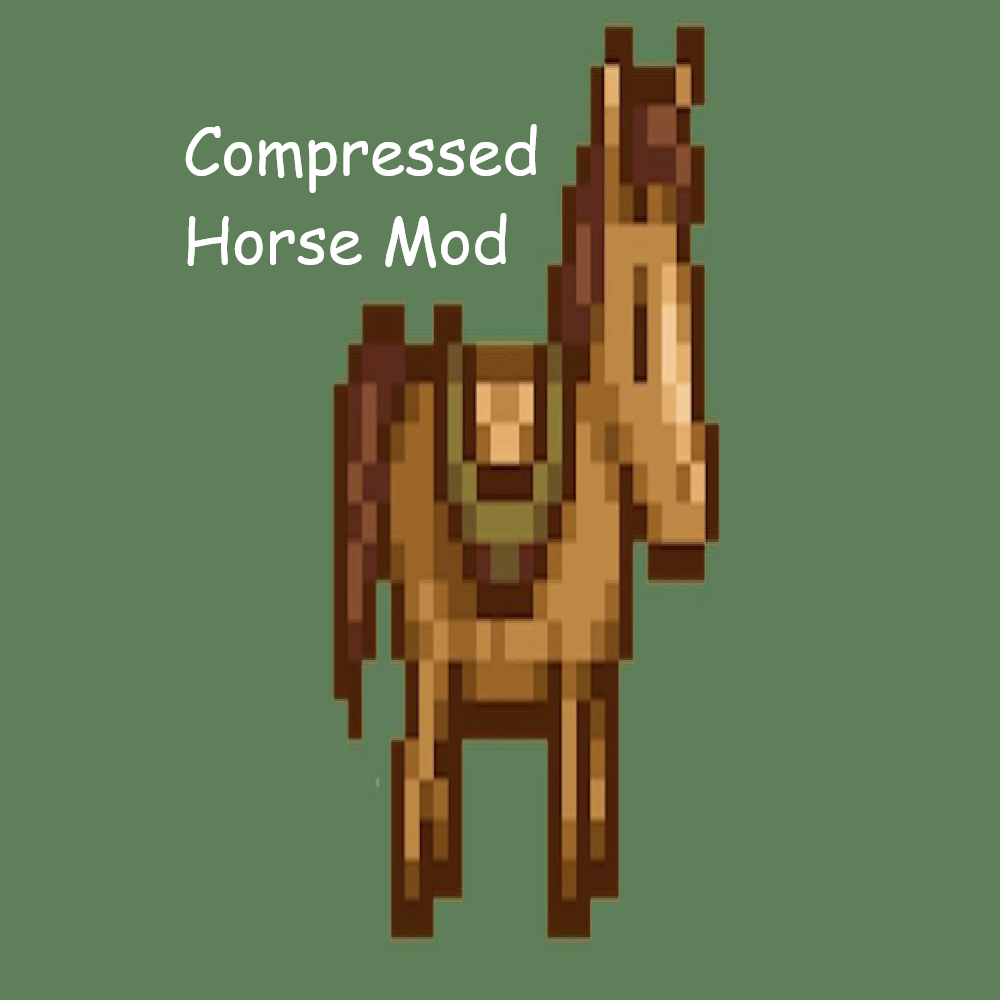

# Compressed Horse



Your horse can now squeeze through one-tile gaps. Anywhere you can walk, you can ride.

## Features
- Slimmer hitbox while riding (vanilla needs a two-tile gap).
- Optional: walk through parked horses (off by default).

## Requirements
- Stardew Valley 1.6 and [SMAPI](https://smapi.io) 4.0+
- [Generic Mod Config Menu](https://www.nexusmods.com/stardewvalley/mods/5098) (optional, for settings)

## Install
Drag the release zip into Vortex, or unzip it into `Stardew Valley/Mods`. In multiplayer, each
player needs the mod.

## Build
```
dotnet build -c Release
```
The zip is written to `dist/`.

## License
Copyright (C) 2026 ChromaMods. Released under the [GNU GPL v3](LICENSE): you are free to use,
modify and share it, as long as you credit ChromaMods and share your changes under the same license.
